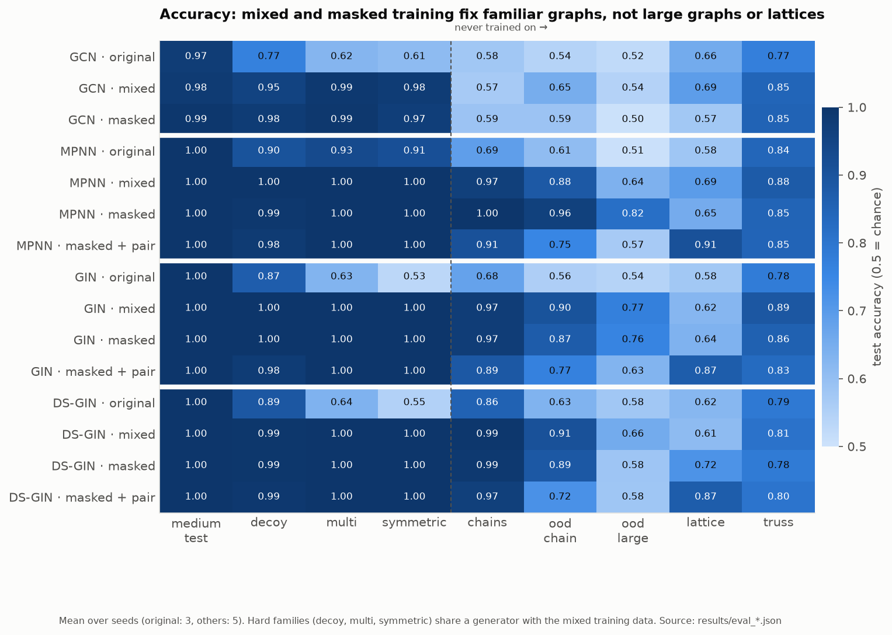
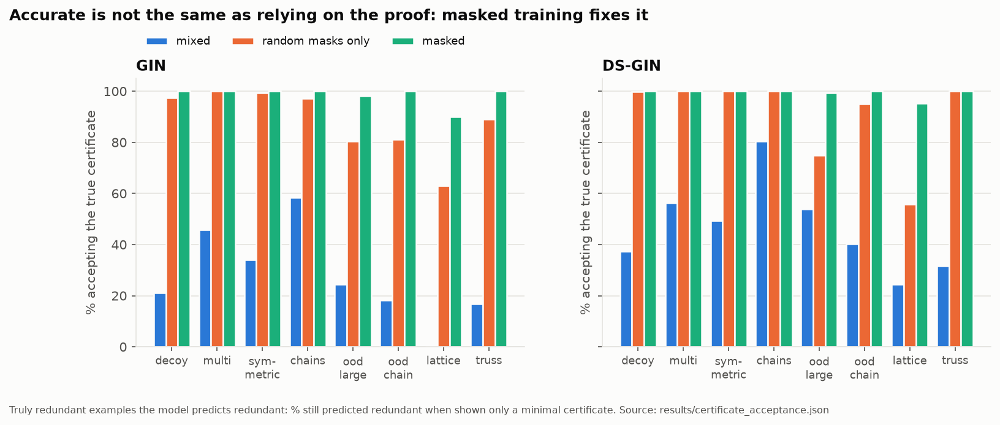
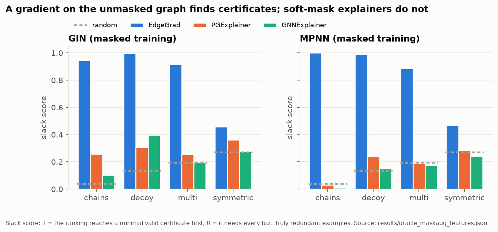
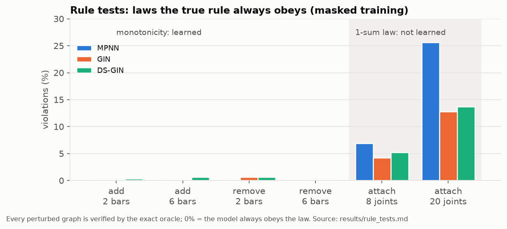
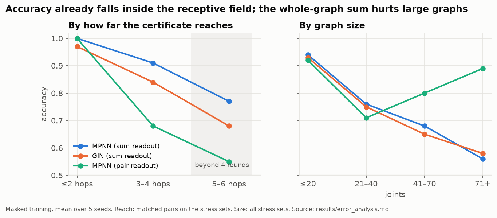
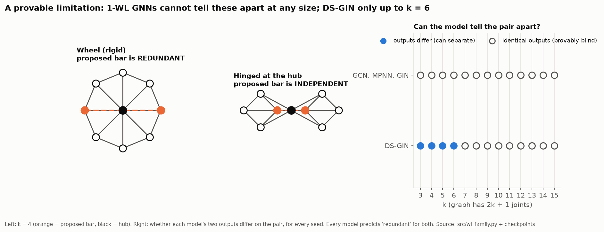

# Symmetry-Consistent GNN Explanations for Graph Rigidity

**Course:** CMPSC 292F — Machine Learning on Graphs  
**University:** University of California, Santa Barbara  
**Team:** Elijah-Amir Hodges & Salaar Saraj  
**Final Deadline:** December 11, 2026  

## Project Overview

GNN explanation methods can assign different importance to edges that are
structurally interchangeable, and an explanation that preserves a model's
prediction need not reflect the true mathematical reason for it. We study both
problems on **generic two-dimensional bar-and-joint rigidity**, where the
ground truth is exactly computable.

**Task (edge level).** Given a base graph and a proposed non-edge `(u, v)`,
predict whether adding it is **independent** (label 0) or **redundant**
(label 1). For a redundant edge, a **rigidity circuit** through it is a
verifiable certificate: the subset of bars that already fixes the distance
between `u` and `v`.

**Research question.** Can enforcing graph symmetry make explanations more
consistent and better aligned with valid rigidity certificates, without
sacrificing faithfulness to the model? We compare raw explanations, orbit
averaging and whole-orbit selection, and grade every explanation with an
exact rigidity oracle on two independent axes: *faithful* (the model keeps its
prediction on the explanation alone) and *valid* (the explanation alone proves
redundancy).

Running notes, findings and design decisions are in
[`notes/edge_task_design.md`](notes/edge_task_design.md).

## Results at a Glance

Six figures summarizing what we have found so far. Regenerate them from the
saved results with `python scripts/make_figures.py` (writes `figures/*.png`).
The full log of everything tried, with all tables, is in
[`notes/edge_task_design.md`](notes/edge_task_design.md).

**1. Accuracy across training regimes.** Mixed and masked training make every
model near-perfect on familiar graph families and transfer to Elijah's unseen
chains, but no regime solves large Laman graphs, and lattices improve only with
the endpoint-only ("pair") readout.



**2. Accuracy is not the same as relying on the proof.** After mixed training,
GIN is ~100% accurate on the hard families yet keeps its "redundant" answer
when shown only the true certificate in just 21–58% of cases. Training on
oracle-labelled masked subgraphs fixes this; random masks alone already give
most of the gain.



**3. Explainers.** A gradient on the unmasked graph (EdgeGrad) reaches a
minimal valid certificate almost immediately; GNNExplainer and PGExplainer,
which optimize soft masks starting from half-strength edges, are near the
random baseline. On symmetric graphs every ranking ties symmetric copies, which
is the symmetry-versus-minimality conflict.



**4. Rule tests.** Models obey monotonicity (adding bars keeps redundancy,
removing bars keeps independence) but not the 1-sum law: attaching a graph at a
single joint changes their answer, more often the larger the attachment.



**5. Where models fail.** Accuracy already drops when the certificate lies
3–4 hops away, inside what a 4-round model can see, so limited reach is not the
main cause. The whole-graph sum readout makes models size-sensitive; the pair
readout recovers on the largest graphs but loses accuracy at medium sizes.



**6. A provable limitation.** A wheel (rigid, the bar is redundant) and two
wheels sharing a hub (a hinge at a cut vertex, the bar is independent) receive
identical 1-WL colorings at every size, so GCN, MPNN and GIN output identical
values on both. DS-GIN separates them only up to k = 6, so both expressive power
and depth are needed. See `src/wl_family.py`.



## Setup

Python 3.11. Everything runs on CPU (graphs have at most ~20 nodes).

**Linux / macOS**

```bash
python3.11 -m venv .venv            # or: uv venv --python 3.11 .venv
.venv/bin/pip install torch==2.5.1 --index-url https://download.pytorch.org/whl/cpu
.venv/bin/pip install -r requirements.txt
.venv/bin/python -m pytest -q tests
```

**Windows (PowerShell)**

```powershell
py -3.11 -m venv .venv
.\.venv\Scripts\python.exe -m pip install torch==2.5.1 --index-url https://download.pytorch.org/whl/cpu
.\.venv\Scripts\python.exe -m pip install -r requirements.txt
.\.venv\Scripts\python.exe -m pytest -q tests
```

Generated data (`data/generated/`, `data_new/`) and results (`results/`) are
gitignored; every file is reproducible with the commands below (fixed seeds).

## Repository Layout

| Path | Contents |
|---|---|
| `src/rigidity_labels.py` | PyRigi labels and fundamental circuits for independent bases |
| `src/oracle.py` | Exact generic 2D rigidity rank / redundancy for **any** edge set (incl. dependent bases); validated against PyRigi |
| `src/laman.py` | Random Laman graphs via Henneberg moves |
| `src/edge_dataset.py` | Base dataset: Laman graph minus k edges, every non-edge labeled, balanced per base, isomorphism-grouped splits |
| `src/hard_generator.py` | Hard families (`decoy`, `multi`, `symmetric`), each built as feature-matched (independent, redundant) pairs |
| `src/laman_loader.py`, `src/laman_diagnostics.py`, `src/chain_graphs.py` | Zenodo Laman dataset loader, feature-matched pairs, glued Laman chains (Elijah) |
| `src/data.py` | JSON record → PyG `Data`; the edge-alignment contract (below) |
| `src/models.py` | Model ladder: `features`, `gcn`, `mpnn`, `gin`, `dsgin` |
| `src/orbits.py` | Edge orbits under automorphisms fixing the candidate; orbit averaging / whole-orbit selection |
| `src/certify.py` | Certificate extraction from a ranking, alternative certificates, faithful selection, symmetric certificate sets |
| `src/ood_generator.py`, `src/truss_generator.py` | Out-of-distribution stress suite (large Laman graphs, long chains, diluted triangular lattices) and damaged bridge trusses |
| `src/wl_family.py` | Wheel vs. hinged-wheels family that no 1-WL GNN can separate |
| `figures/` | Summary figures shown above (`scripts/make_figures.py`) |
| `scripts/` | Data builders, training, explainers, evaluation and tables (see Pipeline) |
| `tests/` | Unit tests (`pytest -q tests`) |
| `notes/` | Design notes and findings |

## Data Format

Each example is one JSON record:

| Field | Description |
|---|---|
| `graph_id`, `base_id` | Example id; base graph (or matched pair) id |
| `num_nodes` | Number of joints |
| `edges` | Base bars, sorted `[u, v]` pairs with `u < v`; **undirected edge `i` is `edges[i]`** |
| `candidate_edge` | Proposed bar (never in `edges`) |
| `label` | `0` independent, `1` redundant |
| `circuit_edges` | A minimal certificate including the candidate (redundant only), else `null` |
| `certificates` | Hard families: all minimal certificates found (several when the base is dependent) |
| `split` | `train` / `val` / `test` |
| `family` | Construction family (hard / mixed sets) |

**Edge-alignment contract** (`src/data.py`): `edge_index` column `2i` is
`u_i → v_i` and `2i+1` is `v_i → u_i`; a directed edge mask folds back to one
score per undirected edge with `directed_to_undirected`. The candidate is not
in `edge_index`; it is passed as `candidate` and marked in node feature
`x[:, 1]`.

## Models

| Model | Expressivity | Notes |
|---|---|---|
| `features` | none | MLP on 7 hand-made features (shortcut check) |
| `gcn` | < 1-WL | normalized mean aggregation |
| `mpnn` | ≤ 1-WL | MLP messages + GRU update |
| `gin` | = 1-WL | |
| `dsgin` | > 1-WL | node-marked subgraph GNN |

All graph models read the candidate pair symmetrically, are permutation
equivariant (no random features or Laplacian eigenvectors), and read the
graph only through message-passing layers so explainer edge masks reach them.

## Pipeline

All commands from the repository root (`python` = `.venv/bin/python`).

**1. Data**

```bash
python scripts/build_edge_dataset.py --bases-per-config 150 --seed 1 --out data/generated/edge_medium.json
python scripts/build_hard_dataset.py --per-class 60 --seed 0 --out data_new/generated/hard_eval.json   # held-out hard set
python scripts/build_mixed_dataset.py          # medium + 11-16-node + hard families (different seed) -> mixed_train.json
python scripts/build_masked_augmentation.py    # + oracle-labeled masked subgraphs -> mixed_masked_train.json
```

Stress sets (evaluation only; every record has `split = "test"`):

```bash
# 14-16-node size control: ordinary Henneberg construction, larger graphs
python scripts/build_edge_dataset.py --nodes 14 16 --deletes 1 2 3 --bases-per-config 40 --seed 7 --out /tmp/large.json
python -c "import json; d=json.load(open('/tmp/large.json')); [r.__setitem__('split','test') for r in d['records']]; json.dump(d, open('data_new/generated/henneberg_large_eval.json','w'))"
```

Elijah's matched-pair and chain sets need the Zenodo Laman graphs
(`LamanGraphs3-10.zip`, extracted to `data/raw/laman/`). The evaluation files
`data_new/generated/{laman,chain}_matched_eval.json` are his generator outputs
with every record routed to `split = "test"`:

```bash
python scripts/diagnose_laman.py
python scripts/build_chain_sample.py
```

**2. Train** (writes `results/<name>/seed<k>/{model.pt, metrics.json}` and `summary.json`)

```bash
python scripts/train.py --data data/generated/edge_medium.json --model gin --seeds 0 1 2 --name ladder_gin_medium
python scripts/train.py --data data_new/generated/mixed_train.json --model dsgin --layers 3 --seeds 0 1 2 3 4 --name mixed_dsgin
```

**3. Stress-test accuracy** (no retraining; includes matched-pair accuracy and leakage-excluded accuracy)

```bash
python scripts/eval_checkpoints.py --data data/generated/edge_medium.json data_new/generated/hard_eval.json
python scripts/wl_diagnostic.py --data data/generated/edge_medium.json     # 1-WL accuracy ceiling
```

**4. Explain** (GNNExplainer, PGExplainer, EdgeGrad, random and oracle baselines; dumps per-example scores and orbits)

```bash
python scripts/explain_prelim.py --run results/ladder_gin_medium --seed-ckpt 0 --n-per-class 150
python scripts/explain_prelim.py --run results/ladder_gin_medium --seed-ckpt 0 \
    --data data_new/generated/hard_eval.json --fit-data data/generated/edge_medium.json --n-per-class 180
```

`--fit-data` supplies train/val examples (temperature fitting, PGExplainer
training) for evaluation-only files. Explainers explain the model's
prediction, not the true label. EdgeGrad is the gradient of the predicted
class w.r.t. per-edge message weights on the unmasked graph (no soft-mask
initialization at 0.5).

**5. Grade with the exact oracle and build tables**

```bash
python scripts/oracle_eval.py     # results/oracle_tables.md: faithful × valid 2×2, graded metrics, symmetry corrections
python scripts/make_tables.py     # results/tables.md: datasets, accuracy ladder, explainer quality
```

`oracle_eval.py` also grades the explanation-side fixes from `src/certify.py`:
`cert` (any ranking → shortest valid prefix → greedy pruning to a minimal
certificate), `cert_faith` (the most model-faithful of several alternative
certificates) and, on symmetric graphs, set-valued explanations (a minimal
certificate plus its symmetry images, each member minimal, the set
symmetry-closed).

**One command for steps 3–5** on a group of trained runs:

```bash
scripts/run_eval_sweep.sh data_new/generated/mixed_train.json mixed_features mixed_gcn mixed_mpnn mixed_gin mixed_dsgin
# -> results/eval_mixed_features.md (accuracy) and results/oracle_mixed_features.md (explanations)
```

## Key Findings So Far

Details and numbers: [`notes/edge_task_design.md`](notes/edge_task_design.md).

- In distribution, faithfulness and mathematical validity coincide; explainers
  rarely recover a minimal certificate (search failure, not model failure).
- Out of distribution they diverge: some models reject true certificates
  (GCN/GIN on chains), others accept non-certificates (MPNN on decoys).
- With non-unique certificates, deletion-based necessity is ill-posed, and
  whole-orbit selection measurably loses minimality on symmetric graphs.
- No single architecture is uniformly best; explanation quality varies more
  across checkpoints than across architectures.
- Fixes under evaluation: training on oracle-labeled masked subgraphs
  (model side) and certificate-constrained, set-valued explanations
  (explanation side). Validity of `cert` explanations is guaranteed by the
  oracle and is not itself a contribution; the question is which certificate
  is faithful to the model.

## Guardrails

- Every explanation method is compared on the same split and checkpoint.
- Symmetry-consistent explanations are not necessarily correct or faithful;
  whole-orbit selection may exceed the top-k budget (reported as overshoot).
- Rigidity circuits are not ground truth for every example: independent
  candidates have none, and minimally rigid (Laman) graphs contain no circuits.
- Labels and certificates are checked against PyRigi in the tests.

## References

### Software and Datasets

- [PyRigi Documentation](https://pyrigi.github.io/PyRigi/)
- [PyTorch Geometric](https://pytorch-geometric.readthedocs.io/)
- [NetworkX](https://networkx.org/documentation/stable/)
- [Laman Graph Dataset — Zenodo](https://zenodo.org/records/1245517)

### Research Papers

- Ying et al. (2019). *GNNExplainer: Generating Explanations for Graph Neural Networks.*
- Luo et al. (2020). *Parameterized Explainer for Graph Neural Network.*
- Xu et al. (2019). *How Powerful Are Graph Neural Networks?*
- Bevilacqua et al. (2022). *Equivariant Subgraph Aggregation Networks.*
- Gilmer et al. (2017). *Neural Message Passing for Quantum Chemistry.*
- Jacobs & Hendrickson (1997). *An Algorithm for Two-Dimensional Rigidity Percolation: The Pebble Game.*
- Xu et al. (2026). *Automorphism-Induced Non-Canonicity in Top-k Explanations of Graph Neural Networks.*
